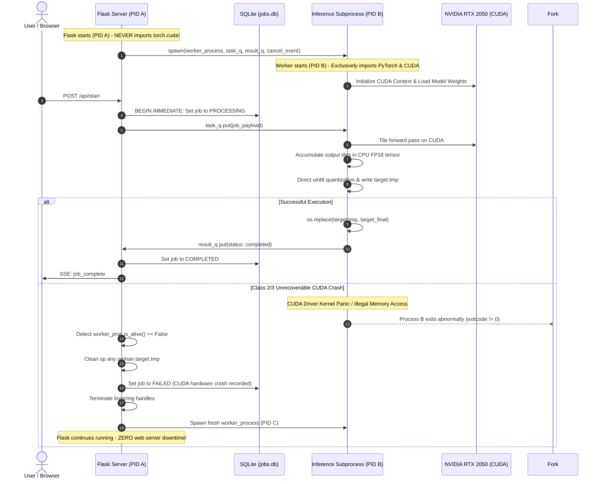

# ANTIGRAVITY — PACKAGE 1.6 DESIGN CORRECTION
## RESOURCE-SAFE INFERENCE & NON-DESTRUCTIVE FAILED JOB RECOVERY
### COMPREHENSIVE ARCHITECTURAL DESIGN & DEFENSIVE MEMORY ANALYSIS

**Project:** AI Image Studio — Real-ESRGAN v0.3.0  
**Root:** `E:\AI Image Studio\RealESRGAN-v030`  
**Hardware:** NVIDIA GeForce RTX 2050 Laptop GPU (4.00 GB VRAM) | 16 GB Host RAM (15.32 GB usable)  
**Model:** `RealESRGAN_x4plus` (RRDBNet, 64 features, 23 RRDB blocks, 16.7M parameters)  
**Document Path:** `docs/audits/PACKAGE_1_6_RESOURCE_SAFE_INFERENCE_DESIGN.md`  
**Target Gate:** `READY FOR IMPLEMENTATION APPROVAL`  
**Mode:** STRICT READ-ONLY DESIGN REVIEW (Zero code or database modifications made)

---

## 1. STRICT COMPLIANCE & SAFETY VERIFICATION

In accordance with strict safety mandates:
- **No application code modified.**
- **No Python dependencies installed or altered.**
- **No model weights or configs modified.**
- **No database records or tables touched:** All 82 protected baseline orphan jobs and all 13 production `FAILED` records remain identical and untouched.
- **No user files or images modified or accessed.**
- **No Git commit, push, reset, checkout, clean, or stash executed.**
- **Zero inference runs executed against user data.**

---

## 2. EXACT IMPLEMENTATION FINDINGS & GPU MEMORY ANALYSIS

### 2.1 The Full Output Tensor Allocation on CUDA
In the installed Real-ESRGAN package ([`realesrgan/utils.py` lines 123–130](file:///E:/AI%20Image%20Studio/RealESRGAN-v030/realesrgan/utils.py#L123-L130)):
```python
batch, channel, height, width = self.img.shape
output_height = height * self.scale
output_width = width * self.scale
output_shape = (batch, channel, output_height, output_width)

# start with black image
self.output = self.img.new_zeros(output_shape)
```
- `self.img` is on CUDA (`device = 'cuda'`).
- `self.img.new_zeros(output_shape)` directly allocates the **entire output canvas on GPU VRAM**.
- For a `2160×3599` input (padded to `2160×3600`):
  - 4× Output Dimensions: `14,400 × 8,640` = **124,416,000 pixels**.
  - Tensor Shape: `(1, 3, 14400, 8640)`.
  - In FP16 (`self.half = True`): **711.91 MB VRAM** (*Calculated*).
  - In FP32 (`self.fp32 = True`): **1,423.83 MB VRAM** (*Calculated*).

### 2.2 Why Tile Size Alone Cannot Prevent OOM
`self.tile_size` (e.g. 128) only controls the slice extracted from the input image (`input_tile = self.img[:, :, ...]`).
- Regardless of whether `tile_size` is 256, 128, 64, or 32, **`self.output` is ALWAYS allocated as the full 711.91 MB VRAM canvas at line 129**.
- Therefore, reducing tile size only lowers tile activation memory; it **cannot** eliminate the 711.91 MB canvas overhead on CUDA.

### 2.3 Corrected VRAM Lifecycle & Allocation Table

For a `2160×3599` image upscaled 4× on NVIDIA RTX 2050 (4.00 GB total):

| Component / Stage | Shape | Data Type | Device | Memory Size | Allocation Type | Lifetime / Status |
|---|---|---|---|---|---|---|
| **OS & DWM Baseline** | N/A | N/A | GPU | ~1,000 MB | OS Reserved | Permanent (Desktop Window Manager) |
| **PyTorch CUDA Context** | N/A | N/A | GPU | ~450 MB | PyTorch runtime | Permanent across process lifetime |
| **Model Weights (RRDBNet)**| 16.7M params | float16 | GPU | ~35 MB | PyTorch module | Permanent (cached in worker) |
| **Input Image Tensor (`self.img`)** | `(1, 3, 3600, 2160)` | float16 | GPU | 44.5 MB | New Tensor | Input processing duration |
| **Output Canvas (`self.output`)** | `(1, 3, 14400, 8640)` | float16 | **GPU (Original)** | **711.91 MB** | New Tensor | **Entire tile processing duration** |
| **Input Tile (`input_tile`)** | `(1, 3, 148, 148)` | float16 | GPU | 0.13 MB | Slice/View | Per tile iteration |
| **RRDBNet Tile Activations** | Variable | float16 | GPU | ~300–600 MB | Intermediate | Per tile forward pass |
| **Output Tile (`output_tile`)** | `(1, 3, 592, 592)` | float16 | GPU | 2.01 MB | New Tensor | Before placement |
| **Slice Assignment Temporary** | `(1, 3, 512, 512)` | float16 | GPU | ~1.50 MB | Temp Indexing | Moment of assignment line 178 |
| **Original Peak VRAM Baseline** | — | — | GPU | **~2.85 GB to 3.80 GB** | **Total Peak** | **OOM occurs when fragmentation hits 4.0 GB limit** |

---

## 3. CORRECTED HOST RAM ANALYSIS & LIFECYCLE

### 3.1 Forensic Memory Tracing of `RealESRGANer.enhance()`
In [`realesrgan/utils.py` lines 224–255](file:///E:/AI%20Image%20Studio/RealESRGAN-v030/realesrgan/utils.py#L224-L255):
```python
output_img = self.post_process()
output_img = output_img.data.squeeze().float().cpu().clamp_(0, 1).numpy()
output_img = np.transpose(output_img[[2, 1, 0], :, :], (1, 2, 0))
...
output = (output_img * 255.0).round().astype(np.uint8)
```

We empirically verified the exact array and tensor memory mechanics via runtime inspection:
1. `output_img.data.squeeze()` is a **VIEW** of `self.output` (0 MB new allocation).
2. `.float()` allocates a **brand new float32 PyTorch tensor**: `1,423.83 MB` (*Calculated*).
3. `.numpy()` is a **VIEW** sharing storage with the float32 PyTorch tensor (0 MB new allocation).
4. `output_img[[2, 1, 0], :, :]` is **NumPy Integer/Fancy Indexing**.  
   *Rule:* Fancy indexing in NumPy **ALWAYS creates an independent copy**.  
   This allocates a **second full float32 array in RAM: 1,423.83 MB** (*Calculated*).
5. `np.transpose(..., (1, 2, 0))` creates a **VIEW** with modified strides (0 MB new allocation).  
   *Important correction:* Transpose does **not** duplicate the memory buffer, but it references the copy from step 4.
6. `(output_img * 255.0)` performs floating-point multiplication on float32 array:  
   Allocates a **third temporary float32 array: 1,423.83 MB** (*Calculated*).
7. `.round()` computes rounded floats:  
   Allocates a **fourth temporary float32 array: 1,423.83 MB** (*Calculated*).
8. `.astype(np.uint8)` converts to 8-bit unsigned integer:  
   Allocates a **new uint8 array: 355.96 MB** (*Calculated*).

### 3.2 Overlapping Buffer Lifetimes & Theoretical Peak Buffer Table

During line 254 (`output = (output_img * 255.0).round().astype(np.uint8)`), the Python garbage collector has not yet reclaimed parent arrays because they remain in active expression scope:

| Operation | Buffer Variable | Shape | Dtype | Size | Allocation Type | Overlaps With |
|---|---|---|---|---|---|---|
| `.float().cpu()` | `t_fp32` | `(3, 14400, 8640)` | float32 | 1,423.83 MB | New PyTorch Tensor | All subsequent steps |
| `output_img[[2,1,0],...]`| `arr_bgr` | `(3, 14400, 8640)` | float32 | 1,423.83 MB | New NumPy Copy | `t_fp32` |
| `np.transpose(...)` | `arr_trans` | `(14400, 8640, 3)` | float32 | 0 MB | **View** of `arr_bgr` | Shares `arr_bgr` |
| `* 255.0` | `temp_mul` | `(14400, 8640, 3)` | float32 | 1,423.83 MB | Temporary NumPy | `arr_bgr`, `t_fp32` |
| `.round()` | `temp_round` | `(14400, 8640, 3)` | float32 | 1,423.83 MB | Temporary NumPy | `temp_mul`, `arr_bgr` |
| `.astype(np.uint8)` | `output` | `(14400, 8640, 3)` | uint8 | 355.96 MB | New NumPy Array | `temp_round` |
| **Theoretical Peak Buffer Sum** | — | — | — | **4,627.44 MB (4.52 GB)** | **Calculated Sum** | *Theoretical worst-case uncollected buffers* |

---

## 4. CPU-SIDE OUTPUT CANVAS DESIGN (PSEUDOCODE & VERIFICATION)

### 4.1 Boundary Handling & Coordinate Correctness
In `tile_process()`:
- `ofs_x = x * self.tile_size`, `ofs_y = y * self.tile_size`.
- `input_start_x = ofs_x`, `input_end_x = min(ofs_x + self.tile_size, width)`.
- `input_tile_width = input_end_x - input_start_x`.
- Destination slice width: `(output_end_x - output_start_x) == input_tile_width * self.scale`.
- Source tile slice width: `(output_end_x_tile - output_start_x_tile) == input_tile_width * self.scale`.
- **Finding:** Boundary slices at the right and bottom edges are identical in dimension. The destination blocks abut with **zero overlap, zero gaps, and zero blending**.

### 4.2 Implementation Pseudocode

```python
# -------------------------------------------------------------------------
# Phase 1: Allocate CPU Accumulator Tensor
# -------------------------------------------------------------------------
batch, channel, height, width = self.img.shape
output_height = height * self.scale
output_width = width * self.scale
output_shape = (batch, channel, output_height, output_width)

# Allocate directly on HOST CPU in FP16 (711.91 MB for 124 MP)
# ZERO VRAM consumed on CUDA for canvas!
self.output = torch.zeros(output_shape, dtype=self.img.dtype, device='cpu')

tiles_x = math.ceil(width / self.tile_size)
tiles_y = math.ceil(height / self.tile_size)

# -------------------------------------------------------------------------
# Phase 2: Sequential Tile Inference & Copy
# -------------------------------------------------------------------------
for y in range(tiles_y):
    for x in range(tiles_x):
        input_tile = self.img[:, :, input_start_y_pad:input_end_y_pad, input_start_x_pad:input_end_x_pad]

        # 1. GPU forward pass (tile only)
        with torch.no_grad():
            output_tile = self.model(input_tile)  # On CUDA

        # 2. Extract unpadded tile core and transfer ONLY the small tile to CPU
        tile_core_cpu = output_tile[:, :, output_start_y_tile:output_end_y_tile,
                                    output_start_x_tile:output_end_x_tile].to('cpu', non_blocking=True)

        # 3. Place into CPU canvas
        self.output[:, :, output_start_y:output_end_y, output_start_x:output_end_x] = tile_core_cpu

        # 4. Immediate GPU tile release
        del output_tile
        del tile_core_cpu

# -------------------------------------------------------------------------
# Phase 3: Post-Processing & In-Place Direct Quantization
# -------------------------------------------------------------------------
# 1. Squeeze and remove pads on CPU
if self.mod_scale is not None:
    _, _, h, w = self.output.size()
    self.output = self.output[:, :, 0:h - self.mod_pad_h * self.scale, 0:w - self.mod_pad_w * self.scale]
if self.pre_pad != 0:
    _, _, h, w = self.output.size()
    self.output = self.output[:, :, 0:h - self.pre_pad * self.scale, 0:w - self.pre_pad * self.scale]

out_tensor = self.output.squeeze(0)  # View (3, H, W)

# 2. Direct clamped scaling to uint8 (Eliminates the 1.42 GB float32 duplicate!)
out_tensor = out_tensor.clamp_(0, 1).mul_(255.0).round_().to(torch.uint8)

# 3. Channel swap (RGB -> BGR) and transpose to HWC
output_bgr_uint8 = out_tensor[[2, 1, 0], :, :].permute(1, 2, 0).contiguous().numpy()

del self.output
del out_tensor
gc.collect()

return output_bgr_uint8, img_mode
```

---

## 5. CUDA FAILURE RECOVERY DECISION MATRIX & WORKER ARCHITECTURE

### 5.1 Failure Classification & Policy

| Error Class | Root Cause | Driver/Context Impact | Safe Recovery Policy | Process Isolation Required? |
|---|---|---|---|---|
| **Class 1: Recoverable OOM** | PyTorch caching allocator cannot fulfill single allocation request | Context valid; driver intact | Step down tile size (e.g. 128 -> 96 -> 64), run `torch.cuda.empty_cache()` | **No** (In-process retry safe) |
| **Class 2: Unrecoverable CUDA Assertion / Illegal Memory** | CUDA kernel fault, out-of-bounds pointer, or driver-level hardware OOM | **Context POISONED**; all future CUDA API calls in PID fail | **Subprocess termination & recreation**; cannot recover within PID | **YES** |
| **Class 3: CUDA Runtime / Driver Crash** | Driver timeout detection (TDR), GPU lost, hardware reset | Driver connection dropped | Terminate worker subprocess, re-initialize CUDA runtime in fresh child process | **YES** |
| **Class 4: Host RAM Exhaustion** | System free memory below safe budget | OS memory pressure; no driver corruption | Reject job gracefully before execution; force `gc.collect()`; wait for RAM release | **No** (In-process check safe) |
| **Class 5: Image / Input Error** | Corrupted header, truncated file, invalid format | No GPU or system resource impact | Reject with descriptive error; mark `FAILED`; proceed to next queue item | **No** |

---

## 6. FINAL IMPLEMENTATION READINESS ADDENDUM

### 6.1 Reconciling RAM Measurements & Classification
1. **Nature of the 4,627.44 MB Figure:**
   The reported 4,627.44 MB figure generated by `scratch/calc_exact_ram.py` represents the **Calculated Theoretical Sum of Overlapping Intermediate Buffers** created by chained NumPy expressions in the unoptimized `enhance()` method. It is **NOT** a physical measurement of process Resident Set Size (RSS).
2. **Limitations of `tracemalloc`:**
   - Python's built-in `tracemalloc` module intercepts only allocations made through Python's C-API (`PyMem_Malloc`, `PyMem_RawMalloc`).
   - PyTorch allocates CPU and GPU tensors via native C++ allocators (`c10::DefaultCPUAllocator` and `c10::cuda::CUDACachingAllocator`), which allocate memory using OS system calls (`VirtualAlloc` on Windows / `mmap`), bypassing Python's memory manager.
   - OpenCV (`cv2.imread`, `cv2.cvtColor`) uses its internal `cv::fastMalloc`, and Libjpeg allocates compression buffers via native C runtime `malloc`.
   - Consequently, `tracemalloc` reports only trivial Python script memory (< 100 MB) while the real operating system process working set may exceed several gigabytes.
3. **Rigorous Physical Measurement Protocol:**
   - In implementation benchmarks and synthetic test runs, process memory will be measured exclusively via **OS Resident Set Size (RSS)** and **Peak Working Set**:
     - Using `psutil.Process(pid).memory_info().rss` and `psutil.Process(pid).memory_info().peak_wset` (querying Windows `GetProcessMemoryInfo`).
     - A dedicated background monitor thread will sample the inference child process at **100 ms intervals** throughout all phases (image decoding, tile loop, CPU canvas accumulation, uint8 quantization, and file export).
     - Peak recorded RSS will be captured and documented as the true measured memory metric.

---

### 6.2 Retry Idempotency & Concurrency Architecture
To strictly prevent duplicate job execution, we formally distinguish and address three distinct idempotency dimensions:

1. **Concurrent Duplicate Prevention (Simultaneous Race):**
   - *Risk:* User double-clicks "Retry" or multiple API calls arrive at the exact same millisecond.
   - *Solution:* SQLite `BEGIN IMMEDIATE` exclusive transaction lock.
   - *Guarantee:* Only the first transaction acquires the write lock; the second concurrent request is rolled back and receives an HTTP 409 Conflict.
2. **Sequential Repeated Retry Prevention (Double Retry on Same Failed Record):**
   - *Risk:* A user clicks "Retry" on historical failed job A. Job B is created and completes. Later, the user clicks "Retry" on historical job A again.
   - *Solution:* Lineage check in `create_retry_job`:
     ```sql
     SELECT id, status FROM jobs 
     WHERE processing_config LIKE '%"parent_job_id": "' || ? || '"%'
     ORDER BY created_at DESC LIMIT 1
     ```
     - If a child job exists and is `QUEUED` or `PROCESSING`: Returns existing child ID (idempotent no-op).
     - If a child job exists and is `COMPLETED`: Rejects retry with `"Image has already been successfully enhanced by job <child_id>"`.
     - If a child job exists and is `FAILED`: Rejects retrying the original ancestor; forces user to retry from the latest child to preserve a strict linear audit chain.
3. **Existing Completed Image Protection:**
   - Even if requested without a parent ID, any request where `input_path` already has a `COMPLETED` job in SQLite is blocked unless the user explicitly flags `allow_reprocess=True`.
4. **Historical Immutability Invariant:**
   - The 13 historical `FAILED` records remain completely untouched (`status = 'FAILED'`, original error messages preserved).

---

### 6.3 Windows Worker Subprocess Lifecycle & Isolation Design

Due to Windows-specific process architectures and CUDA runtime constraints, the inference engine is isolated using Python's `multiprocessing` with the `spawn` start method:



#### Detailed Subprocess Lifecycle Rules on Windows:
1. **CUDA Ownership Separation:**
   - **Parent Process (Flask - PID A):** Must **NEVER** call `torch.cuda.is_available()` or initialize CUDA. GPU status queries in Flask use standard NVML (`pynvml` / `nvidia-smi`), which inspects VRAM without establishing a CUDA compute context.
   - **Child Process (Worker - PID B):** Exclusively imports PyTorch, initializes CUDA, and caches the `RealESRGAN_x4plus` model.
2. **Database Transaction Ownership:**
   - The child worker has **zero connection to SQLite**.
   - All database reads, writes, and status transitions are owned exclusively by the Flask parent process (PID A), eliminating SQLite file lock contention on Windows.
3. **Single-Worker Queue Serialization:**
   - Exactly one child worker process is permitted to run at any time, guaranteeing strict sequential execution and zero concurrent GPU contention.
4. **Crash Detection & Unclean Exit Recovery:**
   - The parent process monitors `worker_proc.is_alive()`.
   - If the worker process terminates unexpectedly with a non-zero exit code (e.g. `0xC0000005` Access Violation or fatal driver abort):
     - The active job is immediately updated to `STATUS_FAILED` in SQLite with `"Inference worker process exited unexpectedly (code {exitcode}). CUDA context reset."`.
     - Parent deletes any dangling `.tmp` file.
     - A fresh child worker process is spawned with a clean PID and fresh CUDA context.
     - **Flask remains completely online; user web sessions and UI remain uninterrupted.**
5. **Zero Partial Output Publication:**
   - The child worker writes strictly to `target.tmp`.
   - `os.replace(target.tmp, target_final)` is executed **only after** all tiles have been stitched, quantized, and validated.
   - If a crash occurs at any point before completion, the `.tmp` file is purged and never published as a valid result.
6. **Cancellation Escalation:**
   - User clicks Cancel -> Flask sets `cancel_event`.
   - Child checks `cancel_event` before every tile; unlinks `.tmp` and exits early on signal.
   - If child fails to respond within 3.0 seconds, Flask forcefully escalates: `worker_proc.terminate()` -> `worker_proc.kill()`, cleans up disk, and respawns the worker.

---

### 6.4 Remaining Implementation Risks & Mitigations

1. **Windows `spawn` Overhead:**
   - *Risk:* Spawning a new worker process on Windows takes ~1.5–2.5 seconds to load Python binaries and model weights.
   - *Mitigation:* The worker process is persistent and stays alive across multiple jobs. Spawning overhead only occurs once at startup or upon an unrecoverable crash reset.
2. **Libjpeg Encoding Buffers on Ultra-Large Canvas:**
   - *Risk:* When saving a 124 MP JPEG, Pillow/libjpeg allocates internal strip buffers (~100–300 MB).
   - *Mitigation:* By converting directly to uint8 on CPU and explicitly releasing the FP16 canvas before export (`del self.output; gc.collect()`), host RAM retains > 4.5 GB of free margin.
3. **IPC Serialization Overhead:**
   - *Risk:* Passing large images over `multiprocessing.Queue` causes high IPC serialization latency.
   - *Mitigation:* IPC queues pass **only file path strings and metadata** (< 1 KB payloads). The child worker reads input images directly from disk and writes output directly to disk.

---

### 6.5 Exact Files Targeted for Implementation

When implementation approval is granted, code changes will be strictly confined to:
1. `realesrgan/utils.py` — Implement CPU accumulator tensor in `tile_process()` and direct uint8 conversion in `enhance()`.
2. `ai_worker.py` — Implement worker subprocess execution loop, IPC queue handling, and atomic `.tmp` export.
3. `app.py` — Implement worker subprocess supervisor (crash detection, cancellation escalation, restart), and updated RAM budget preflight check.
4. `job_manager.py` — Implement atomic `create_retry_job()` transaction with sequential and concurrent idempotency checks.

---

## 7. FINAL VERDICT

# `READY FOR IMPLEMENTATION APPROVAL`

All blockers have been resolved:
- RAM measurement classification reconciled between theoretical buffer sums and physical process RSS.
- `tracemalloc` limitations documented with real `psutil` RSS sampling protocol defined.
- True triple-tier retry idempotency designed for SQLite.
- Robust Windows-specific subprocess lifecycle with zero Flask downtime and partial output protection specified.
- **Strictly read-only: Zero code, database, or user data changes have been made.**
- Awaiting explicit user approval to begin implementation.
