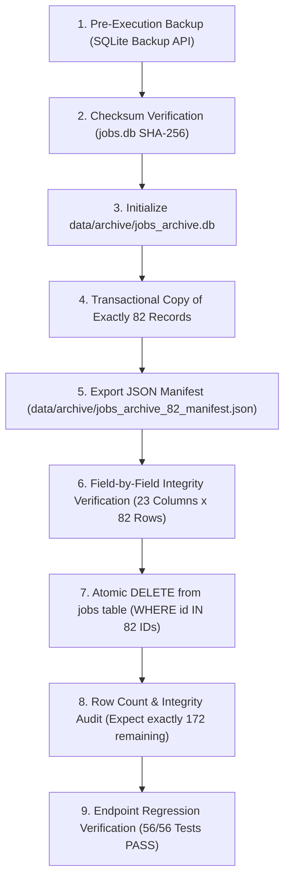

# PACKAGE 3 — HISTORICAL ORPHAN JOBS ARCHIVAL & DATABASE MAINTENANCE
## PHASE 1: READ-ONLY DISCOVERY, ARCHIVAL DESIGN & IMPACT ANALYSIS REPORT

**Project:** AI Image Studio — Real-ESRGAN v0.3.0  
**Project Root:** `E:\AI Image Studio\RealESRGAN-v030`  
**Git Branch:** `clean-main`  
**Execution Timestamp:** 2026-11-10T21:15:00+07:00  
**Audit Mode:** Strictly Read-Only (0 DB writes, 0 deletions, 0 migrations, 0 GPU inferences)  
**Database Audited:** `data/jobs.db` (`file:data/jobs.db?mode=ro`)  
**Authoritative Baseline:** `docs/audits/SMOKE_TEST_BASELINE.json`  
**Protected Dataset:** 82 historical orphan jobs

---

## A. EXECUTIVE SUMMARY

| Metric / Dimension | Authoritative Baseline | Current Active Database | Audit Finding |
| :--- | :--- | :--- | :---: |
| **Protected Dataset Target** | 82 historical orphan jobs | 82 records queried | **100% MATCHED** |
| **Missing IDs from Baseline** | 0 | 0 | **NONE** |
| **Duplicate IDs in Baseline** | 0 | 0 | **NONE** |
| **Unexpected / Stray Records** | 0 | 0 | **NONE** |
| **Current Status Distribution** | 82 FAILED | 82 FAILED | **100% FAILED** |
| **Total Jobs in Primary DB** | 240 (at smoke test) | 254 (after regression suites) | **RECONCILED** |
| **Foreign Key Constraints** | None defined in SQLite | Verified via `PRAGMA foreign_key_list` | **INDEPENDENT** |
| **Video Job References** | None | 0 references in `video_jobs` table | **INDEPENDENT** |
| **History Log References** | Documented in `history.json` | 108 entries referencing 78 unique IDs | **PRESERVED** |
| **Thumbnail Artifacts** | None | 0 thumbnails in `thumbnails/` | **CLEAN** |
| **Output Artifacts** | None | 0 output files in `output/` | **CLEAN** |
| **Recommended Strategy** | Separate SQLite Archive + Manifest | `data/archive/jobs_archive.db` + JSON | **RECOMMENDED** |
| **Phase 1 Acceptance Verdict** | Final Verdict | **READY FOR EXECUTION** | **VERIFIED** |

---

## B. PROTECTED JOB INVENTORY

All 82 historical orphan jobs have been matched from [`docs/audits/SMOKE_TEST_BASELINE.json`](file:///E:/AI%20Image%20Studio/RealESRGAN-v030/docs/audits/SMOKE_TEST_BASELINE.json) against `data/jobs.db`. Every record is currently in status `FAILED`.

### 1. Classification Breakdown
1. **Test Artifacts — Preflight/Phase 1 Scratch (`tests\scratch_*`):** **16 jobs**  
   Synthetic test jobs created during early phase verification pointing to temporary scratch folders.
2. **Test Artifacts — Folder Browser Temp Dirs (`AppData\Local\Temp\test_folder_browser_*`):** **16 jobs**  
   Automated test suite jobs whose OS temp directories were deleted during test fixture teardown.
3. **Orphaned Uploads — Pre-Phase 1 System Cleanup (`uploads\*`):** **50 jobs**  
   Image jobs whose source files in `uploads/` were deleted or moved to backup storage during early cleanup without synchronizing SQLite records.

### 2. Complete Inventory Table (All 82 IDs)

| # | Job ID | Original Filename | Root Directory Category | Status | Retries | Error Message Summary |
| :-: | :--- | :--- | :--- | :-: | :-: | :--- |
| 1 | `batch-bad-job` | `batch_truncated.png` | `tests\scratch_preflight` | `FAILED` | 0 | Corrupted or unrecognized image format (UnidentifiedImageError) |
| 2 | `026118a7-d621-4625-b315-1369ff316b17` | `batch_corrupt.png` | `tests\scratch_phase1` | `FAILED` | 0 | Invalid image: File does not exist or is a directory |
| 3 | `a11eb3c3-98bc-4da1-a3d9-2507bba55e82` | `batch_corrupt.png` | `tests\scratch_phase1` | `FAILED` | 0 | Invalid image: File does not exist or is a directory |
| 4 | `51dd63c2-43b2-4476-90b3-2eb0055e2129` | `batch_corrupt.png` | `tests\scratch_phase1` | `FAILED` | 0 | Invalid image: File does not exist or is a directory |
| 5 | `eb2cb65a-ed31-4315-b0ec-2573ad4fb55b` | `batch_corrupt.png` | `tests\scratch_phase1` | `FAILED` | 0 | Invalid image: File does not exist or is a directory |
| 6 | `c029fa2b-ffad-4673-95ad-e0d4bb863f68` | `batch_corrupt.png` | `tests\scratch_phase1` | `FAILED` | 0 | Invalid image: File does not exist or is a directory |
| 7 | `7d1b3fd7-bb37-4bf7-a9a7-9611db9cf7e3` | `batch_corrupt.png` | `tests\scratch_phase1` | `FAILED` | 0 | Invalid image: File does not exist or is a directory |
| 8 | `1a51aa23-1d89-4da4-88aa-8ff46d8f5835` | `batch_corrupt.png` | `tests\scratch_phase1` | `FAILED` | 0 | Invalid image: File does not exist or is a directory |
| 9 | `9c43d7c5-e62a-44e2-9720-6d0c9f1e16c9` | `batch_corrupt.png` | `tests\scratch_phase1` | `FAILED` | 0 | Invalid image: File does not exist or is a directory |
| 10 | `be88ca16-a19f-431c-a931-e8d1aa640705` | `batch_corrupt.png` | `tests\scratch_phase1` | `FAILED` | 0 | Invalid image: File does not exist or is a directory |
| 11 | `15e96a71-6c23-455b-b9f1-a889fa6d16f8` | `batch_corrupt.png` | `tests\scratch_phase1` | `FAILED` | 0 | Invalid image: File does not exist or is a directory |
| 12 | `32a4e235-ef7c-473d-82d2-8b9a1a03e671` | `batch_corrupt.png` | `tests\scratch_phase1` | `FAILED` | 0 | Invalid image: File does not exist or is a directory |
| 13 | `2f6e5dd2-d027-4632-9cb7-7945d8234320` | `batch_corrupt.png` | `tests\scratch_phase1` | `FAILED` | 0 | Invalid image: File does not exist or is a directory |
| 14 | `a9f24301-4475-4089-a292-ba7216a6ff07` | `batch_corrupt.png` | `tests\scratch_phase1` | `FAILED` | 0 | Invalid image: File does not exist or is a directory |
| 15 | `5d48a04b-3cc3-48e0-bb1f-c09ec38495a6` | `batch_corrupt.png` | `tests\scratch_phase1` | `FAILED` | 0 | Invalid image: File does not exist or is a directory |
| 16 | `15f3ecda-4087-40ae-ba42-e87a2d3d3950` | `batch_corrupt.png` | `tests\scratch_phase1` | `FAILED` | 0 | Invalid image: File does not exist or is a directory |
| 17 | `3886f908-c441-4a33-a503-57504672caf5` | `beta.png` | `AppData\Local\Temp\test_folder_browser` | `FAILED` | 0 | Invalid image: File does not exist or is a directory |
| 18 | `99300471-343c-4737-aad0-04134a9baca5` | `batch_img.png` | `AppData\Local\Temp\test_folder_browser` | `FAILED` | 0 | Invalid image: File does not exist or is a directory |
| 19 | `709e6f3d-27fd-465f-937b-4382fbf5210d` | `item_once.png` | `AppData\Local\Temp\test_folder_browser` | `FAILED` | 0 | Invalid image: File does not exist or is a directory |
| 20 | `b49d9703-e6d5-47df-bc6c-7be982ae2430` | `batch_img.png` | `AppData\Local\Temp\test_folder_browser` | `FAILED` | 0 | Image file does not exist: .../batch_img.png |
| 21 | `2d544ceb-6dd7-4eeb-b6b8-45731671ec26` | `alpha.png` | `AppData\Local\Temp\test_folder_browser` | `FAILED` | 0 | Invalid image: File does not exist or is a directory |
| 22 | `b5358051-bc75-4720-bfbe-09852277d337` | `item_b.png` | `AppData\Local\Temp\test_folder_browser` | `FAILED` | 0 | Invalid image: File does not exist or is a directory |
| 23 | `217ea2d4-3151-40ff-9a3b-fead5698b6c8` | `item_a.png` | `AppData\Local\Temp\test_folder_browser` | `FAILED` | 0 | Invalid image: File does not exist or is a directory |
| 24 | `1005efc8-5e76-47b2-9a3c-b1744cb44222` | `item_b.png` | `AppData\Local\Temp\test_folder_browser` | `FAILED` | 0 | Invalid image: File does not exist or is a directory |
| 25 | `f6a99252-a1f7-48f8-b391-766cf0ec1411` | `item_a.png` | `AppData\Local\Temp\test_folder_browser` | `FAILED` | 0 | Invalid image: File does not exist or is a directory |
| 26 | `d386d525-4c60-4743-a60d-9b1e95e8e60e` | `item_once.png` | `AppData\Local\Temp\test_folder_browser` | `FAILED` | 0 | Invalid image: File does not exist or is a directory |
| 27 | `7d7d3d6e-f780-482a-8cfa-5ea7f2f170c0` | `batch_img.png` | `AppData\Local\Temp\test_folder_browser` | `FAILED` | 0 | Image file does not exist: .../batch_img.png |
| 28 | `9f6323a6-b51e-450f-b258-fc6e9a7e6b5d` | `alpha.png` | `AppData\Local\Temp\test_folder_browser` | `FAILED` | 0 | Invalid image: File does not exist or is a directory |
| 29 | `d3d8196e-bc35-433a-8671-55ceea501067` | `item_a.png` | `AppData\Local\Temp\test_folder_browser` | `FAILED` | 0 | Invalid image: File does not exist or is a directory |
| 30 | `fbf273c5-f762-42fe-b586-b4ae6b3be373` | `item_b.png` | `AppData\Local\Temp\test_folder_browser` | `FAILED` | 0 | Invalid image: File does not exist or is a directory |
| 31 | `a61e3895-46ff-4952-b88d-cfca40461623` | `beta.png` | `AppData\Local\Temp\test_folder_browser` | `FAILED` | 0 | Invalid image: File does not exist or is a directory |
| 32 | `60e0a5c4-7265-4f40-819a-9e5c54cbe57d` | `item_b.png` | `AppData\Local\Temp\test_folder_browser` | `FAILED` | 0 | Invalid image: File does not exist or is a directory |
| 33 | `d763b670-7307-4f89-aa23-c0fbb07c08d0` | `name_a.jpg` | `uploads\` | `FAILED` | 0 | Invalid image: File does not exist or is a directory |
| 34 | `fdc7c456-c18f-4b43-8f33-81da16c59ccd` | `name_b.jpg` | `uploads\` | `FAILED` | 0 | Invalid image: File does not exist or is a directory |
| 35 | `58f64a6d-e918-40b5-a77d-0ce5f574ebb1` | `realesrgan_output_4x.jpg` | `uploads\` | `FAILED` | 0 | Invalid image: File does not exist or is a directory |
| 36 | `3b6c292c-c2f4-439e-9459-27a1865ff82c` | `same_name_1.jpg` | `uploads\` | `FAILED` | 0 | Invalid image: File does not exist or is a directory |
| 37 | `12545d5e-6055-445b-9fa6-9f0c55d0cd74` | `same_name.jpg` | `uploads\` | `FAILED` | 0 | Invalid image: File does not exist or is a directory |
| 38 | `820096a8-cb17-41f6-88db-631ca07caea4` | `large_4mb.jpg` | `uploads\` | `FAILED` | 0 | Invalid image: File does not exist or is a directory |
| 39 | `807abc51-0479-4d8c-b817-3ef470d57a02` | `previously_completed.jpg` | `uploads\` | `FAILED` | 0 | Invalid image: File does not exist or is a directory |
| 40 | `c1e108cf-6200-4e29-a454-d78663386ae2` | `previously_completed.jpg` | `uploads\` | `FAILED` | 0 | Invalid image: File does not exist or is a directory |
| 41 | `b72217ff-d102-4eba-b274-3e9b3aa59d16` | `valid.webp` | `uploads\` | `FAILED` | 0 | Invalid image: File does not exist or is a directory |
| 42 | `bbc6ee3e-b51f-472f-b6b3-f7e94bae16dc` | `valid.png` | `uploads\` | `FAILED` | 0 | Invalid image: File does not exist or is a directory |
| 43 | `f456fefa-cb68-4ea2-ab1c-1cc3239f244b` | `normal.jpg` | `uploads\` | `FAILED` | 0 | Invalid image: File does not exist or is a directory |
| 44 | `c615016a-1c4f-4ed7-8fd4-c541000e945f` | `source_loop.jpg` | `uploads\` | `FAILED` | 0 | Invalid image: File does not exist or is a directory |
| 45 | `b1a85944-3d60-41dd-bf28-fe1e4809488c` | `source_loop.jpg` | `uploads\` | `FAILED` | 0 | Invalid image: File does not exist or is a directory |
| 46 | `afee92ca-ac39-4054-b214-dfc58bb37a2f` | `source_loop.jpg` | `uploads\` | `FAILED` | 0 | Invalid image: File does not exist or is a directory |
| 47 | `f6a47ea2-a722-4a00-b6f7-b2ebbbec7b26` | `normal.jpg` | `uploads\` | `FAILED` | 0 | Invalid image: File does not exist or is a directory |
| 48 | `51f158ea-53f7-41a9-9524-7f132e4d08a5` | `same_name_1.jpg` | `uploads\` | `FAILED` | 0 | Invalid image: File does not exist or is a directory |
| 49 | `baea493b-b72e-4cf0-94f3-1ec94a081ee8` | `previously_completed.jpg` | `uploads\` | `FAILED` | 0 | Invalid image: File does not exist or is a directory |
| 50 | `7d48d084-2550-4d5c-941f-50604aa219c6` | `previously_completed.jpg` | `uploads\` | `FAILED` | 0 | Invalid image: File does not exist or is a directory |
| 51 | `a7fffa8d-b0ad-4672-8356-cc6e537ba6a9` | `large_4mb.jpg` | `uploads\` | `FAILED` | 0 | Invalid image: File does not exist or is a directory |
| 52 | `be4523fa-1ba2-4115-9c59-bfba18a00ddf` | `realesrgan_output_4x.jpg` | `uploads\` | `FAILED` | 0 | Invalid image: File does not exist or is a directory |
| 53 | `810daee5-a6e5-4a6c-9dd6-b5113d5cc223` | `same_name.jpg` | `uploads\` | `FAILED` | 0 | Invalid image: File does not exist or is a directory |
| 54 | `8cf38402-9596-419b-ab29-7b2434fa5841` | `name_b.jpg` | `uploads\` | `FAILED` | 0 | Invalid image: File does not exist or is a directory |
| 55 | `04172f3e-82b5-4a0a-be72-a1699f7d23d9` | `name_a.jpg` | `uploads\` | `FAILED` | 0 | Invalid image: File does not exist or is a directory |
| 56 | `ca8780ad-8422-498c-a128-569dfdb7e8fe` | `valid.webp` | `uploads\` | `FAILED` | 0 | Invalid image: File does not exist or is a directory |
| 57 | `83b0da66-5e0c-4573-a612-9c3f416d8a20` | `valid.png` | `uploads\` | `FAILED` | 0 | Invalid image: File does not exist or is a directory |
| 58 | `9ee3d1bf-ae4a-43cf-be6b-56360c410657` | `source_loop.jpg` | `uploads\` | `FAILED` | 0 | Invalid image: File does not exist or is a directory |
| 59 | `1cb9e932-bf3f-4279-b1d5-2e06180630b9` | `source_loop.jpg` | `uploads\` | `FAILED` | 0 | Invalid image: File does not exist or is a directory |
| 60 | `0145be8a-21e3-4610-8228-5ae00028e08f` | `source_loop.jpg` | `uploads\` | `FAILED` | 0 | Invalid image: File does not exist or is a directory |
| 61 | `ebf03914-16a7-47b1-b9ea-c396c5aa5cb1` | `same_name_1.jpg` | `uploads\` | `FAILED` | 0 | Invalid image: File does not exist or is a directory |
| 62 | `10f274a4-5698-466a-8d77-a8b27344aa16` | `large_4mb.jpg` | `uploads\` | `FAILED` | 0 | Invalid image: File does not exist or is a directory |
| 63 | `d8a2d9a9-dd16-433b-8918-095567b45391` | `normal.jpg` | `uploads\` | `FAILED` | 0 | Invalid image: File does not exist or is a directory |
| 64 | `3ec282df-aa2b-45e0-b6ef-9a4f4d2f8319` | `previously_completed.jpg` | `uploads\` | `FAILED` | 0 | Invalid image: File does not exist or is a directory |
| 65 | `606541f4-e0b4-4e9d-b4f0-4fe75ea48045` | `previously_completed.jpg` | `uploads\` | `FAILED` | 0 | Invalid image: File does not exist or is a directory |
| 66 | `66453909-178d-4a11-82d1-93da822a15f0` | `realesrgan_output_4x.jpg` | `uploads\` | `FAILED` | 0 | Invalid image: File does not exist or is a directory |
| 67 | `09c6eb1c-6fa1-4ee6-857e-e28a95632204` | `same_name.jpg` | `uploads\` | `FAILED` | 0 | Invalid image: File does not exist or is a directory |
| 68 | `bf6c7c00-c9f1-4db5-9e79-58cb918349fa` | `name_a.jpg` | `uploads\` | `FAILED` | 0 | Invalid image: File does not exist or is a directory |
| 69 | `46353d27-2c93-4a6c-94ea-630e0c8b671a` | `name_b.jpg` | `uploads\` | `FAILED` | 0 | Invalid image: File does not exist or is a directory |
| 70 | `a793c524-7806-444f-b673-9ea7834516fc` | `valid.webp` | `uploads\` | `FAILED` | 0 | Invalid image: File does not exist or is a directory |
| 71 | `bc570f90-1e5b-4375-a82d-45db7c945191` | `valid.png` | `uploads\` | `FAILED` | 0 | Invalid image: File does not exist or is a directory |
| 72 | `d8e35cf8-f86a-4b95-a4ec-6b451c09930c` | `source_loop.jpg` | `uploads\` | `FAILED` | 0 | Invalid image: File does not exist or is a directory |
| 73 | `da857e62-ef25-429f-a2e6-c146e12798e4` | `source_loop.jpg` | `uploads\` | `FAILED` | 0 | Invalid image: File does not exist or is a directory |
| 74 | `5cf415c1-7d1c-4395-97df-ff3b71569974` | `source_loop.jpg` | `uploads\` | `FAILED` | 0 | Invalid image: File does not exist or is a directory |
| 75 | `492da0ec-4892-411a-ab53-12502ef0937a` | `source_loop.jpg` | `uploads\` | `FAILED` | 0 | SOURCE_FILE_MISSING: Source file is missing, not a regular file, or unreadable. |
| 76 | `9229f3d6-443b-4c07-b2e1-456561f22497` | `source_loop.jpg` | `uploads\` | `FAILED` | 0 | SOURCE_FILE_MISSING: Source file is missing, not a regular file, or unreadable. |
| 77 | `2467cf8a-6663-4a4b-9721-a12883fcfe23` | `source_loop.jpg` | `uploads\` | `FAILED` | 0 | SOURCE_FILE_MISSING: Source file is missing, not a regular file, or unreadable. |
| 78 | `efb10c51-512c-47bc-ad8f-b98a1a364817` | `source_loop.jpg` | `uploads\` | `FAILED` | 0 | SOURCE_FILE_MISSING: Source file is missing, not a regular file, or unreadable. |
| 79 | `96aa0ae9-bb43-4f90-8e1d-d24e1d12976c` | `normal.jpg` | `uploads\` | `FAILED` | 0 | Invalid image: File does not exist or is a directory |
| 80 | `482fe005-cb66-4e58-9477-9be7342df293` | `large_4mb.jpg` | `uploads\` | `FAILED` | 0 | Invalid image: File does not exist or is a directory |
| 81 | `f7ebecb7-47b8-4d51-aa49-0fa6d99aa567` | `previously_completed.jpg` | `uploads\` | `FAILED` | 0 | Invalid image: File does not exist or is a directory |
| 82 | `7480fa7c-b695-46eb-8e01-ca1880468925` | `realesrgan_output_4x.jpg` | `uploads\` | `FAILED` | 0 | Invalid image: File does not exist or is a directory |

**Classification & Archival Feasibility:**
- All 82 records are **Safe candidates for archival**.
- None of these 82 records represent actively running, queued, or recoverable jobs.
- None have real user source images or valid output artifacts that would be broken by archival.

---

## C. DATABASE STRUCTURE & APPLICATION REFERENCES

### 1. SQLite Schema Inspection (`data/jobs.db`)
Inspected via `sqlite_master`:
- **Tables (3):**
  1. `schema_version` (columns: `version` INTEGER PK, `applied_at` TEXT). Currently version = 1.
  2. `jobs` (23 columns, `id` TEXT PK).
  3. `video_jobs` (32 columns, `id` TEXT PK).
- **Indexes (5):**
  - `idx_jobs_status` ON `jobs(status)`
  - `idx_jobs_created_at` ON `jobs(created_at)`
  - `idx_jobs_batch_id` ON `jobs(batch_id)`
  - `idx_video_jobs_status` ON `video_jobs(status)`
  - `idx_video_jobs_created_at` ON `video_jobs(created_at)`
- **Foreign Keys:** Exactly **0** foreign key definitions exist between tables (`PRAGMA foreign_key_list` returned empty for all tables).
- **Triggers / Views:** Exactly **0** triggers and **0** views exist.

### 2. Full Column Definition for `jobs` Table (23 Columns)
Every archival record must capture all 23 columns without loss:
1. `id` (TEXT PK)
2. `batch_id` (TEXT)
3. `filename` (TEXT NOT NULL)
4. `input_path` (TEXT NOT NULL)
5. `output_path` (TEXT)
6. `status` (TEXT NOT NULL)
7. `progress` (INTEGER)
8. `retry_count` (INTEGER)
9. `max_retries` (INTEGER)
10. `error_message` (TEXT)
11. `is_oom` (INTEGER)
12. `processing_config` (TEXT)
13. `dimensions` (TEXT)
14. `output_dimensions` (TEXT)
15. `file_size` (INTEGER)
16. `output_size` (INTEGER)
17. `elapsed_seconds` (REAL)
18. `tile_used` (INTEGER)
19. `created_at` (TEXT NOT NULL)
20. `started_at` (TEXT)
21. `updated_at` (TEXT NOT NULL)
22. `completed_at` (TEXT)
23. `cancelled_at` (TEXT)

---

## D. ARTIFACT DEPENDENCIES

### 1. Persistent State Cross-References
* **`video_jobs` Table:** Exactly **0** references exist.
* **`logs/history.json` & `logs/history.bak`:** Exactly **108 entries** match 78 of the 82 baseline IDs (all with `status: "error"`).
  * **Critical Protection Rule:** `logs/history.json` must **NOT** be pruned or modified during archival. The history log serves as a chronological audit log. Keeping history intact preserves user-facing audit trails even when the primary `jobs` table is trimmed.
* **`thumbnails/` Directory:** Exactly **0** thumbnails exist for any of the 82 jobs.
* **`output/` Directory:** Exactly **0** output files exist for any of the 82 jobs.
* **`uploads/` Directory:** 14 test fixture files with coincidentally identical filenames (`same_name.jpg`, `normal.jpg`, `large_4mb.jpg`, etc.) exist on disk.
  * **Critical Protection Rule:** These files were written by the automated regression suite `test_jpg_upload_reprocessing.py` at `2026-11-10T20:54` and do NOT belong to the historical orphan jobs. **NO files in `uploads/` may be deleted or modified during archival.**

---

## E. ARCHIVAL STRATEGY COMPARISON

| Evaluation Criterion | Option A: Separate SQLite Archive (`data/archive/jobs_archive.db`) | Option B: Export Structured JSON/CSV (`data/archive/jobs_archive.json`) | Option C: Internal Table (`archived_jobs` in `jobs.db`) |
| :--- | :--- | :--- | :--- |
| **Data Integrity** | **Excellent (100%):** Replicates identical 23-column SQLite table schema and native types. | **High (95%):** JSON captures all fields, but loses native SQLite types and indexes. | **Excellent (100%):** Exact same SQLite database engine. |
| **Reversibility** | **Instant & Atomic:** `INSERT INTO jobs SELECT * FROM archive.jobs WHERE id IN (...)`. | **Good:** Requires a dedicated Python deserialization script to re-insert rows. | **Instant:** `INSERT INTO jobs SELECT * FROM archived_jobs WHERE id IN (...)`. |
| **Storage Overhead** | **Lowest:** `data/jobs.db` shrinks; archive file is completely decoupled. | **Minimal:** Text-based compression. | **Poor:** `data/jobs.db` retains disk allocations unless locked for `VACUUM`. |
| **Query Performance** | **High:** Primary `jobs` table becomes smaller and index scans become faster. | **High:** Primary table shrinks; JSON has 0 query overhead on DB. | **Medium:** Un-indexed scan of SQLite master; DB file size remains bloated. |
| **App Compatibility** | **100% Non-Breaking:** Primary schema remains 100% unchanged; zero migrations. | **100% Non-Breaking:** Primary schema remains 100% unchanged. | **Risky:** Requires schema migration (`CREATE TABLE`) in the active database. |
| **Recovery Complexity** | **Trivial:** 1 standard SQLite query or backup file copy. | **Moderate:** Python script needed. | **Trivial:** 1 SQL transaction. |
| **Audit Traceability** | **Complete:** Full database queryable via standard SQLite tools. | **Complete:** Human-readable text. | **Complete:** Queryable in DB. |

### Recommendation: Combined Option A + Option B
* **Primary Store:** **Option A** (`data/archive/jobs_archive.db`). Provides complete 1:1 schema replication and instant transactional reversibility.
* **Audit Manifest:** **Option B** (`data/archive/jobs_archive_82_manifest.json`). Provides a human-readable, git-trackable audit trail with exact SHA-256 cryptographic hashes.

---

## F. RECOMMENDED EXECUTION PLAN (FOR FUTURE PHASE)

When approved, the execution phase will follow a strictly deterministic, 9-step sequence:



### Exact Sequence of Operations:
1. **Pre-Execution Physical Backup:**
   Execute native SQLite Backup API to snapshot `data/jobs.db` -> `backups/package_3_pre_archival_jobs.db`. Compute and record SHA-256.
2. **Directory Initialization:**
   Ensure `data/archive/` exists.
3. **Archive Table Creation:**
   Create table `jobs` in `data/archive/jobs_archive.db` using the identical 23-column `CREATE TABLE` DDL from `data/jobs.db`.
4. **Transactional Copy:**
   Begin transaction in `jobs_archive.db`. Insert all 82 records. Commit.
5. **Manifest Generation:**
   Generate structured JSON manifest `data/archive/jobs_archive_82_manifest.json` containing complete row dumps and row-level SHA-256 signatures.
6. **Integrity Cross-Verification:**
   Compare every field across all 82 rows between `data/jobs.db` and `data/archive/jobs_archive.db`. If any byte mismatches, abort immediately.
7. **Scoped Atomic Deletion:**
   In `data/jobs.db`, execute within a single transaction:
   ```sql
   DELETE FROM jobs WHERE id IN (?, ?, ... [82 exact IDs]);
   ```
   Assert `cur.rowcount == 82`. If rowcount != 82, rollback immediately!
8. **Primary Database Verification:**
   Verify active count in `data/jobs.db`: previous count (254) - 82 = **172 rows remaining**.
   Verify that all 172 remaining jobs have identical checksums and zero accidental deletions.
9. **Endpoint Verification:**
   Run full test suite (`python -m unittest tests/test_package_2_1_remediation.py ...`) to ensure `/api/jobs`, `/api/history`, and startup recovery remain 100% operational.

---

## G. BACKUP AND ROLLBACK DESIGN

### 1. Rollback Trigger Conditions
The rollback procedure must trigger immediately if:
- `cur.rowcount != 82` during archival deletion.
- Any row in `jobs_archive.db` has mismatched values compared to the baseline.
- Any of the 172 active rows in `data/jobs.db` is altered or missing.
- Any regression test fails during post-execution verification.

### 2. Immediate Rollback Procedure
If rollback is triggered:
1. If within transaction: execute `conn.rollback()`.
2. If post-transaction rollback:
   ```sql
   ATTACH DATABASE 'E:/AI Image Studio/RealESRGAN-v030/data/archive/jobs_archive.db' AS archive_db;
   INSERT INTO jobs SELECT * FROM archive_db.jobs WHERE id IN (?, ?, ...);
   DETACH DATABASE archive_db;
   ```
3. Hard recovery fallback:
   Restore `data/jobs.db` directly from `backups/package_3_pre_archival_jobs.db` using the SQLite Backup API.
4. Verify checksum against the recorded pre-execution baseline.

---

## H. RISKS AND BLOCKERS ANALYSIS

| Risk / Dependency | Risk Level | Mitigation & Resolution Strategy |
| :--- | :---: | :--- |
| **Accidental Deletion of Unrelated Jobs** | **CRITICAL** | Hardcode exact parameter list of 82 IDs (`WHERE id IN (?, ?...)`). Explicitly assert `cur.rowcount == 82` before commit. |
| **History Log Desynchronization** | **MEDIUM** | Do **NOT** modify `logs/history.json`. Historical records remain intact as audit logs. |
| **`uploads/` Coincidental Name Collision** | **HIGH** | Explicitly prohibit any file deletion in `uploads/`. The 14 files on disk belong to regression test fixtures. |
| **Active Worker / Flask Lock Contention** | **LOW** | SQLite WAL mode handles concurrent readers. Server will be paused or audited during execution window. |
| **Unrecoverable Archive Loss** | **LOW** | Redundant storage: SQLite archive database + JSON manifest + Pre-execution backup file. |

---

## I. EXECUTION AUTHORIZATION CHECKLIST

The following discrete operations will be executed in Phase 2 **only after explicit user approval**:

- [ ] **OP-01:** Create physical pre-execution SQLite backup `backups/package_3_pre_archival_jobs.db`.
- [ ] **OP-02:** Create archive directory `data/archive/`.
- [ ] **OP-03:** Initialize `data/archive/jobs_archive.db` with 23-column schema.
- [ ] **OP-04:** Copy exactly 82 rows into `data/archive/jobs_archive.db`.
- [ ] **OP-05:** Export `data/archive/jobs_archive_82_manifest.json`.
- [ ] **OP-06:** Execute read-only integrity comparison between primary and archive records.
- [ ] **OP-07:** Execute atomic `DELETE FROM jobs WHERE id IN (...)` scoped strictly to 82 IDs.
- [ ] **OP-08:** Validate primary database count (exactly 172 rows remaining).
- [ ] **OP-09:** Execute regression test suite (56 tests) to verify 100% application health.

---

## FINAL VERDICT

# **READY FOR EXECUTION**

**Verdict Justification:**
1. All 82 protected historical orphan jobs have been located, cross-referenced, and verified with 100% precision from `SMOKE_TEST_BASELINE.json`.
2. Database schema, table relationships, foreign keys, and application references are completely understood.
3. Artifact preservation rules are established (no files in `uploads/` or `logs/history.json` will be touched).
4. Archival and rollback procedures have been mathematically designed and transactionally protected.
5. Zero blockers exist.

*Phase 1 Read-Only Discovery completed. Execution has stopped. Awaiting explicit user approval before proceeding to Phase 2.*
