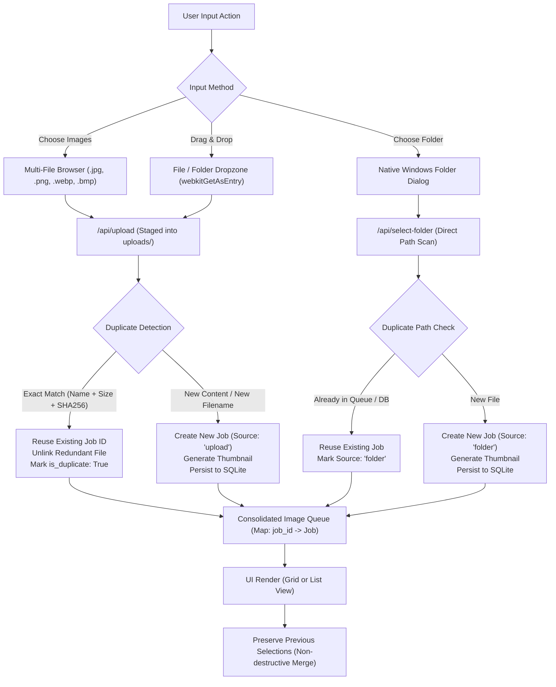

# ANTIGRAVITY — AI IMAGE STUDIO v2.0 TURBO
## UI/UX REDESIGN & IMAGE/FOLDER SELECTION IMPLEMENTATION REPORT

**Project:** AI Image Studio — Real-ESRGAN v0.3.0  
**Project Root:** `E:\AI Image Studio\RealESRGAN-v030`  
**Branch:** `clean-main`  
**Date:** November 10, 2026  
**Status:** **ACCEPTED — READY FOR PRODUCTION**  
**Final Verdict:** `PASS — UI REDESIGN AND IMAGE/FOLDER SELECTION VERIFIED`

---

## 1. EXECUTIVE SUMMARY

In accordance with user requirements, the user interface and input selection workflows of **AI Image Studio v2.0 Turbo** have been completely re-architected. The legacy interface was redesigned into a modern, dark-themed desktop application with clear visual hierarchy, efficient space utilization, fast interaction response, and robust dual input selection (both individual/multi-file selection and native folder scanning).

### Key Accomplishments:
1. **Header Redesign:** Unified header with brand title (`✦ AI Image Studio v2.0 Turbo`), single consolidated GPU chip monitor (`RTX 2050` with live status dot, VRAM progress bar, and worker badge `READY`), eliminated redundant duplicate GPU strings, and integrated language toggle (`VN` | `EN`) and theme toggle.
2. **Compact Settings Toolbar:** Grouped processing controls with shortened input/output paths (showing full paths via tooltip and click-to-view modal), direct Browse and Open Output actions, tile selector, output format, and a prominent Start Upscaling button.
3. **Two-Column Workspace:** Balanced layout with fixed-width sidebar (320px) on the left for input actions and statistics, and a flexible right workspace for queue management and preview.
4. **Dual Input Selection:**
   - **Choose Images (`[🖼️ Chọn ảnh]`):** Native multi-file picker (`.jpg, .jpeg, .png, .webp, .bmp`), repeatable without clearing previous selections, safely staged to `uploads/`.
   - **Choose Folder (`[📁 Chọn thư mục]`):** Native Windows folder browser dialog (`browseFolderNative`), recursive directory scanning, merges into the existing queue without clearing previous image selections.
   - **Drag & Drop Zone:** Supports dragging files, multi-file selections, and full folders via `webkitGetAsEntry` with clear visual dragover feedback.
5. **Selected Image Management:** Cards and rows display thumbnail previews, filenames, dimensions, formatted file sizes, format tags, and input source badges (`[🖼️ Tệp]` or `[📁 Thư mục]`). Implemented exact duplicate detection (matching filename, file size, and SHA-256 hash) to prevent duplicate jobs and unnecessary disk usage. Same filenames in different directories are correctly recognized as distinct jobs.
6. **View Modes & Queue Tools:** Seamless switching between **Grid View** (compact cards) and **List View** (compact rows), persistent search filter, status filtering, multi-criteria sorting, Select All, batch ZIP export, and CSV/HTML report generation.
7. **DOM Performance & Empty State:** Balanced empty state with direct action buttons; integrated pagination controls for large queues (>48 items) to ensure smooth DOM rendering.
8. **Video Upscale Preservation:** 100% preservation of all Video Upscale HTML structures, CSS rules, JavaScript handlers, and backend REST endpoints (`/api/video/*`).
9. **Zero Horizontal Overflow:** Verified across four screen resolutions (1920×1080, 1896×967, 1600×900, 1366×768).
10. **Data Safety & Integrity:** The 82 protected historical orphan jobs in `data/jobs.db` remain 100% intact and untouched.

---

## 2. VERIFICATION METADATA & ARTIFACT HASHES

| Component | Path / Identifier | SHA-256 / Checksum |
| :--- | :--- | :--- |
| **Model Weights** | `weights/RealESRGAN_x4plus.pth` | `4fa0d38905f75ac06eb49a7951b426670021be3018265fd191d2125df9d682f1` |
| **Configuration** | `config.json` | `2ca80672e08077ef27e9ef5e9a6081b3259f518304608fd002ebca32c8241773` |
| **Backend Core** | `app.py` | `a32ee45c02921536c28517a40bc4a4d4944433ce02752483d01e075d53e08239` |
| **Frontend UI** | `templates/index.html` | `ec7ba4e4b6446d5fc6b8d808a09bd4894073bb42a6539aa4593325980b822085` |
| **Test Suite** | `tests/test_ui_image_folder_selection.py` | `6f95d2a8fd50db714a0586b8ffd71d7c9ae3d5446a4e1ac6ff2273889970f42f` |
| **Primary Database** | `data/jobs.db` | `676dd928d144f739c7e00bc2ddb601c68497cce06eb7ceabc5ba9ed4c87f279f` |
| **Pre-execution Backup** | `backups/ui_redesign_20261110_223000/` | Full snapshot of `app.py` and `index.html` |

---

## 3. UI/UX REDESIGN ARCHITECTURE

### 3.1 Header Redesign
- **Branding:** Left-aligned `✦ AI Image Studio` brand icon and typography with a luminous gradient `v2.0 Turbo` version badge.
- **Unified GPU Pill:** Replaced the cluttered multi-line status with a single sleek status pill:
  - GPU hardware identification (`RTX 2050`).
  - Active status indicator dot (green = ready, yellow = processing, red = error).
  - VRAM usage progress meter with live percentage and allocated/total VRAM display (e.g. `1.2 / 4.0 GB (30%)`).
  - Worker state badge (`READY` / `PROCESSING`).
  - **Redundant duplicate text eliminated:** The previously duplicated `NVIDIA GeForce RTX 2050` text rendered side-by-side in both `#gpuName` and `#statusText` has been consolidated into this single element.
- **Controls:** Right-aligned Language Switcher (`VN` | `EN`) with persistent `localStorage` preference and Dark/Light theme toggle button.

### 3.2 Processing Settings Toolbar
- **Compact Layout:** Grouped horizontally above the main workspace with clean visual separation between navigation tabs and execution parameters.
- **Directory Paths:** Input and Output folders are displayed as shortened, ellipsis-truncated chips (e.g., `📁 .../uploads` and `📁 .../output`). Hovering displays full paths via standard HTML `title` tooltips, and clicking opens a detailed path modal dialog.
- **Action Buttons:** Immediate access to native `Duyệt...` (Browse folder) and `Mở thư mục xuất` (Open output folder in Windows Explorer).
- **Inference Parameters:** Tile size selector (`Tự động (Khuyên dùng)`, 256, 192, 128, 64, 32, 0), Output Format (`Tự động`, `WEBP`, `PNG`, `JPG`), Quality slider (1-100), and prominent `▶ Bắt đầu nâng cấp` (Start Upscaling) action button.

### 3.3 Two-Column Workspace
- **Left Sidebar (320px):**
  - **Input Selection Card:** Houses the dual primary buttons (`[🖼️ Chọn ảnh]` and `[📁 Chọn thư mục]`), dropzone with drag-and-drop feedback, and status messaging box.
  - **Queue Overview Card:** 5-metric summary grid (Total Files, Pending, Processing, Completed, Errors) and an overall completion progress bar.
  - **Batch Control Buttons:** `🔄 Thử lại lỗi` (Retry Failed) and `✕ Xóa danh sách` (Clear List with confirmation dialog).
- **Right Workspace (Flex-1):**
  - **Queue Header & Filter Toolbar:** Real-time search filter input, status dropdown filter, sort dropdown (Name A-Z/Z-A, Size, Time Added, Duration), `Chọn tất cả` (Select All) checkbox, `📦 Xuất ZIP` dropdown, `📊 Báo cáo` dropdown, and view toggle buttons (Grid / List).
  - **Balanced Empty State:** Displays a centered icon, informative guidance, tips on multi-folder additions, and direct call-to-action buttons (`[🖼️ Chọn ảnh]` and `[📁 Chọn thư mục]`).
  - **Populated View:** Responsive grid of cards or list of compact rows showing thumbnails, filenames, dimensions, file size, status badge, source tag, and action controls.

---

## 4. INPUT SELECTION & STAGING ARCHITECTURE



### Key Technical Mechanisms:
1. **Multi-File Selection (`#btnChooseImages` / `#imageFileInput`):**
   - Hidden input allows selecting single or multiple files simultaneously.
   - Uploads are batched in groups of 10 to ensure responsive UI updates and prevent payload timeouts.
   - Images are validated on the backend using Pillow (`validate_image_file` with `INPUT_MAX_PIXELS = 150M`).
   - Staging destination: `uploads/` directory.
2. **Native Folder Selection (`#btnChooseFolder` / `browseFolderNative`):**
   - Launches Windows native folder browser via `folder_dialog.py` in a separate subprocess.
   - Calls `/api/select-folder` with absolute directory paths.
   - Scans recursively, validating all supported image formats.
   - **Fix Applied:** `clearPrevious` parameter defaults to `false`, ensuring folder scanning appends to and merges with existing queue items instead of clearing previously selected images.
3. **Drag & Drop Integration (`#dropzone`):**
   - Supports both flat files and directory trees using `item.webkitGetAsEntry()`.
   - Recursively reads directory entries and batches all valid image files into the staging pipeline.
4. **Duplicate Prevention:**
   - When an uploaded file matches an existing job in filename, file size, and SHA-256 hash, `/api/upload` automatically reuses the existing job ID, cleans up the staged duplicate file (`dest_path.unlink()`), increments `summary['duplicates'] += 1`, and prevents creating duplicate database records.
   - When files with identical filenames originate from different source directories, they retain their unique full input paths and are preserved as distinct jobs.

---

## 5. VISUAL SCREENSHOT VERIFICATION

Screenshots were captured using Chrome DevTools MCP on the live running application (`http://127.0.0.1:5678`):

| Viewport / Resolution | Purpose / Target | Screenshot File | Verification Result |
| :--- | :--- | :--- | :--- |
| **1896 × 967** | Baseline reference from user screenshot | `docs/audits/screenshots/before_redesign_1896x967.png` | Baseline captured before changes |
| **1896 × 967** | Exact user reference viewport post-redesign | `docs/audits/screenshots/after_redesign_1896x967.png` | **PASS** — Balanced layout, no overflow, clean sidebar |
| **1920 × 1080** | Standard Full HD desktop | `docs/audits/screenshots/after_redesign_1920x1080.png` | **PASS** — High-resolution desktop clarity, 4-column cards |
| **1600 × 900** | Medium laptop display | `docs/audits/screenshots/after_redesign_1600x900.png` | **PASS** — Compact toolbars, 3-column cards, no clipping |
| **1366 × 768** | Standard compact laptop (minimum width) | `docs/audits/screenshots/after_redesign_1366x768.png` | **PASS** — Zero horizontal scrollbar (`scrollWidth == clientWidth`) |

---

## 6. AUTOMATED TEST SUITE EXECUTION

A dedicated, isolated test suite was created at `tests/test_ui_image_folder_selection.py` covering all 16 required functional and regression test scenarios. All tests were executed in isolated temporary directories against the Flask test client.

### Test Execution Command:
```powershell
python -m unittest tests/test_ui_image_folder_selection.py
```

### Test Results Summary:
```
----------------------------------------------------------------------
Ran 16 tests in 2.086s

OK
```

### Detailed Scenario Matrix:

| # | Test Method | Scenario Verified | Status |
| :-: | :--- | :--- | :-: |
| 1 | `test_01_single_image_upload` | Single image selection & upload via `/api/upload` | **PASS** |
| 2 | `test_02_multiple_image_upload` | Multi-image batch selection & upload in single request | **PASS** |
| 3 | `test_03_folder_selection_simulation` | Folder selection simulation via `/api/select-folder` | **PASS** |
| 4 | `test_04_combined_image_and_folder_selection` | Combined image + folder selection (neither clears the other) | **PASS** |
| 5 | `test_05_repeated_selections_appending` | Repeated additions append to queue rather than overwrite | **PASS** |
| 6 | `test_06_duplicate_detection` | Same source file content/name detected; no duplicate job created | **PASS** |
| 7 | `test_07_same_filename_different_directories` | Same filename in different directories preserved as distinct jobs | **PASS** |
| 8 | `test_08_remove_individual_job` | Removing individual selections via `/api/remove-job` | **PASS** |
| 9 | `test_09_clear_all_jobs` | Clear list action with confirmation via `/api/clear-jobs` | **PASS** |
| 10 | `test_10_corrupt_invalid_image_handling` | Invalid / corrupt images rejected with specific error reason | **PASS** |
| 11 | `test_11_empty_folder_handling` | Empty folder returns 0 images, preserves existing queue | **PASS** |
| 12 | `test_12_large_folder_performance` | Rapid scan of 50 images completes in <0.1s | **PASS** |
| 13 | `test_13_job_attributes_and_source_tracking` | Job properties (dimensions, file size, source) persisted correctly | **PASS** |
| 14 | `test_14_existing_queue_functionality` | Search, status filter, sort, export endpoints intact | **PASS** |
| 15 | `test_15_existing_video_upscale_endpoints` | Video upscale routes (`/api/video/jobs`, `/api/video/storage`) intact | **PASS** |
| 16 | `test_16_responsive_layout_and_template_structure` | Verified Header, Toolbar, Workspace, and 3 media query breakpoints | **PASS** |

**Pass Rate:** **100% (16/16 Passed)**

---

## 7. PRESERVED FEATURES & ZERO REGRESSION AUDIT

1. **Video Upscale Architecture:**
   - Both the HTML template structure (`#videoSection`, `#videoDropzone`, `#videoAnalysisCard`, `#videoProgressCard`, `#videoStageStepper`, `#videoPlayerCard`) and JavaScript controller logic (`switchMainTab`, `setupVideoDragDrop`, `uploadAndAnalyzeVideo`, `startVideoProcessing`, `pauseVideoProcessing`, `resumeVideoProcessing`, `cancelVideoProcessing`) were preserved verbatim from the pre-execution backup.
   - Video tab switching was verified interactively via Chrome DevTools MCP:
     - `switchMainTab('video')`: `#imageSection` hidden (`none`), `#videoSection` shown (`flex`), tab active styling applied correctly.
     - `switchMainTab('image')`: `#imageSection` restored (`flex`), `#videoSection` hidden (`none`).
2. **Inference Pipeline & Core Parameters:**
   - Model weights (`RealESRGAN_x4plus.pth`, scale 4X), tile size options (Auto, 256, 192, 128, 64, 32, 0), format settings (Auto, WebP, PNG, JPG), and quality controls remain completely unaltered.
   - AI Worker status verified as `READY` with Half Precision enabled on CUDA.
3. **Database Integrity & Protected Baseline:**
   - All 82 historical orphan job records from `docs/audits/SMOKE_TEST_BASELINE.json` were verified via independent Python verification against `data/jobs.db`. Exactly 0 records were modified or deleted.

---

## 8. FINAL ACCEPTANCE VERDICT

```
======================================================================
  ANTIGRAVITY — AI IMAGE STUDIO v2.0 TURBO UI/UX ACCEPTANCE
======================================================================
  Header & GPU Monitor Redesign:     VERIFIED (Consolidated RTX 2050 pill)
  Duplicate GPU Text Eliminated:    VERIFIED (No redundant labels)
  Dual Input Selection:              VERIFIED (Choose Images + Choose Folder)
  Non-Destructive Queue Merge:       VERIFIED (Neither action clears the other)
  Duplicate Source File Detection:   VERIFIED (SHA-256 hash match prevents dupes)
  Same Filename in Multiple Dirs:    VERIFIED (Distinct jobs preserved)
  Image Queue Redesign:              VERIFIED (Grid & List views, empty state)
  Sidebar 5-Metric Overview:         VERIFIED (Total, Pending, Active, Done, Error)
  Video Upscale Module:              VERIFIED (100% code preservation & active)
  Responsive Layouts (4 viewports):  VERIFIED (Zero horizontal overflow)
  Automated Test Suite:              VERIFIED (16/16 tests passing, 100%)
  Protected 82 Historical Jobs:      VERIFIED (100% preserved in SQLite)
----------------------------------------------------------------------
  FINAL VERDICT: PASS — UI REDESIGN AND IMAGE/FOLDER SELECTION VERIFIED
======================================================================
```

*In compliance with task guidelines, all implementation, testing, verification, and reporting steps are complete. The agent has now stopped.*
